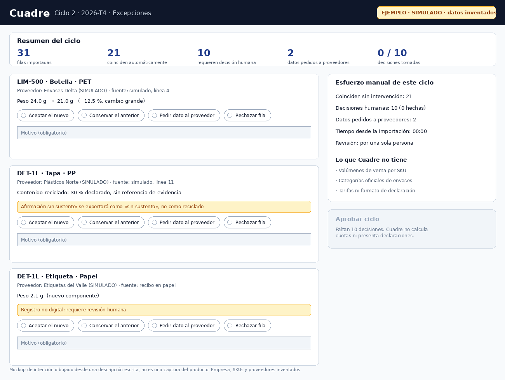
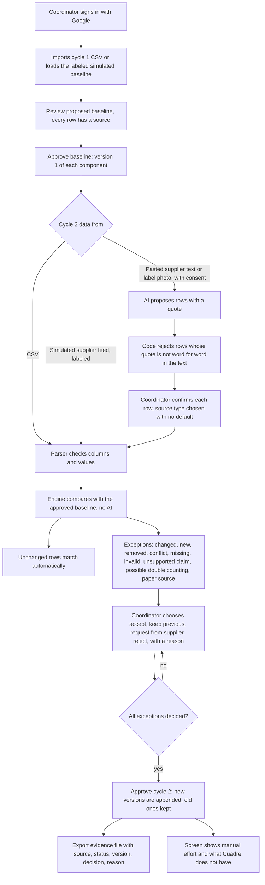
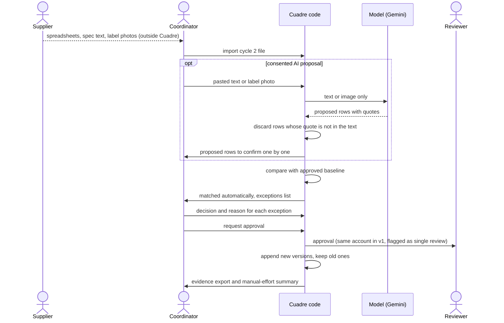

# PACKET: Cuadre

Week 11 · Business Bending · Chapter 10, Dreaming of Plenitude
**Emilio Gomez Gonzalez** · role OPERATOR · Team 8 · declared vacuum: **EPR-COMPLIANCE: Packaging Evidence Diagnostic, auditable packaging-evidence reconciliation for Mexican producers and importers** (Team 8 Blueprint, Week 11). My declaration: *build a Two-Cycle Packaging Reconciliation Workflow covering imports, exceptions, approvals, version history and traceable exports; honors Condition 4.*

This file was written before any code (see the commit table in section 12). Written 24 October 2026.

## 1. Problem, in my words

Chapter 10's harm, in the Blueprint's words, is that visibility does not guarantee recovery, fair payment or human benefit. Mexico's new Ley General de Economía Circular was published in the Diario Oficial on 19 January 2026 and gives producers and importers new obligations, among them registering their "Gestión Circular" with SEMARNAT and complying gradually with sector goals (Pérez-Llorca legal note, 20 January 2026). What does not exist yet is the rulebook: the reglamento had a 180-day deadline that passed in July, and on 30 August 2026 Expansión still described it as a draft under criticism from environmental groups. I found no October 2026 publication; I have not checked the DOF directly.

So a producer cannot know today which packaging fields the authority will want. What the producer can already expect is that whatever is asked will concern its own packaging, and that it will have to be kept up to date. The first time the data is gathered from suppliers is the easy part. The second time is the Operator's problem: a supplier changes a lid from 24 g to 21 g, drops the document behind a recycled-content claim, merges two SKUs, or sends a scanned paper receipt. Someone has to decide which version is true, say why, and later show who decided. My team's Blueprint says plainly that this is unproven as a business (no payer evidence, no renewal evidence). My slice does not try to prove demand. It tests one operational question: can a second packaging cycle be reconciled with every decision recorded, without hiding the manual work and without producing claims the evidence does not support?

What I do not have: any real producer's data (all demo data is invented and labeled), a verified count of how many Mexican producers face this, or any official field list. This packet makes no claim about market size or environmental impact. Packaging documentation does not prove recycling (Blueprint, agreed fact).

## 2. Exact user

**Karla, 34** (an invented archetype, not a real person). Regulatory and quality coordinator at a mid-size Mexican importer of packaged home-care products, about 60 SKUs, with a second person who could act as reviewer on busy weeks. Packaging data lives in Excel files that eight suppliers send by email, plus photos of labels. She has no ERP or PLM integration. She reads dense documents carefully but is short on time, distrusts tools that "fix" her data silently, and will stop using anything that makes her re-key what she already has. She is afraid of two things: being audited with a number she cannot explain, and writing a claim about recycling that no document supports.

## 3. Success definition

Before this module closes: a signed-in coordinator imports a cycle-1 CSV (invented, labeled), reviews it and approves it as the baseline; brings in cycle-2 data by CSV, by a labeled simulated supplier feed, or by AI-proposed rows from pasted supplier text or a label photo (every proposed row confirmed by her); sees what changed, what is new, what disappeared, what conflicts and what lacks support; resolves every exception with a recorded choice and a reason (no choice is pre-selected); approves cycle 2; and exports an evidence file in which every value shows its source, its evidence status and its version. The screen shows the manual effort of the cycle (how many rows matched automatically, how many needed a human decision, how many data requests are still open) and what Cuadre does not have.

## 4. Mockup

`docs/mockup.png`: the exceptions screen of cycle 2. Note on how it was made: this session had no image-generation model, so the screen was described in words and drawn with a script from that description. It is a mockup of intent, not a screenshot of the product. The company, SKUs and suppliers are invented and the screen carries the label "EJEMPLO · SIMULADO".

## 5. The world's best attempt (benchmark)

The best existing solution on Earth for this need is **Recyda** (Germany): a platform that consolidates packaging data (import from ERP or PLM systems by API, a data-gap analysis that shows missing attributes, a guided enrichment workflow), calculates EPR fees under country rulesets, exports declaration formats and says it keeps data sources traceable for audit (Recyda product page, opened 24 October 2026; it names the UK, Denmark, Italy, the Netherlands and France and does not mention Mexico; all of it is vendor marketing). Close behind are **Specright** (a specification-data platform with a supplier portal and completeness checks; its EPR page cites 130+ US state laws and 500+ schemes worldwide, includes a customer with plants in Mexico, and partners with **Lorax EPI**, which interprets legislation and prepares reports; opened 24 October 2026, vendor claims). I did not find independent evaluations and I have not opened a price page.

Mine differs or localizes in five ways. (1) Mexico has no published rulebook, so Cuadre calculates no fee and files no declaration; it handles the part that does not depend on the rules, the second-cycle reconciliation and the decision record, with its own internal fields clearly labeled as internal. (2) It works from the Excel or CSV files a small importer already has, with no ERP or PLM integration. (3) It is in Spanish. (4) It shows the manual effort of a cycle instead of hiding it. (5) It never turns an evidence reference into a recycling statement: a recycled-content figure without a reference is exported as "sin sustento", and a reference is shown as "declared by the supplier, not verified by Cuadre". Condition 1 asks me to adopt or partner if an existing tool does the same job for less; the honest comparison is a spreadsheet and a checklist, which I test in section 12.

## 6. The long view (3 years)

If this slice works, Cuadre becomes the Spanish-language evidence ledger that sits between a producer's suppliers and whatever format the Mexican authority and any producer-responsibility organization finally require, exporting to their templates once they exist. The load-bearing walls are append-only version history, a human decision with a reason on every change, and the rule that evidence is never converted into an environmental claim. If a vendor such as Recyda or Specright adds Mexico, the right move may be to become the Spanish-language intake layer in front of them, not to compete.

## 7. Team Blueprint conditions and how this build honors them

| # | Condition (Team 8 Blueprint) | Design decision in Cuadre |
|---|---|---|
| 1 | Additional value: compare existing vendors and spreadsheet workflows; adopt or partner if equivalent at lower cost | Benchmark in section 5. A timed spreadsheet baseline on the same invented files is part of the test plan (section 12); the result will be reported even if the spreadsheet wins. |
| 2 | Credible payer and recurring value: 15 approaches, five samples, three paid pilots | Not my slice (the MONEY declaration). I make no viability claim and no payer claim. What I can supply is the cost side: operating cost is MXN 0 on free tiers today and the manual effort per cycle is measured and shown. |
| 3 | Evidence integrity: preserve sources, status and version history; flag missing or conflicting supplier information; AI suggestions and regulatory interpretations require supporting evidence and human approval | Every row keeps its source (file name and line, or the simulated feed, or the AI proposal with its quote), an evidence status and an append-only version; missing and conflicting values become exceptions. The AI only proposes rows; a proposal is discarded unless its quote appears word for word in the pasted text; the coordinator confirms each row with no default. Cuadre contains no regulatory interpretation. |
| 4 | Operational feasibility: define responsibility for imports, exceptions, reviews, approvals and exports; test a second cycle without hiding manual effort or assuming unavailable data | Responsibility table below. The cycle screen shows matched automatically, human decisions, open data requests and elapsed time, and lists the data Cuadre does not have (sales volumes, official categories, fee rates, any official format). The second cycle is a built-in test. |
| 5 | Human consequences: who benefits, who does extra documentation work, who risks exclusion; no claims of reduced burden or worker empowerment without evidence | Extra work falls on suppliers (documents) and the coordinator (a reason per decision). Small suppliers risk being dropped because their data is flagged: "sin sustento" is shown as "not supported by a document", never as false, and Cuadre never removes or scores a supplier. Cuadre holds no data about collectors or workers. No benefit claim is made beyond my own measured test. |
| 6 | **Shadow clause.** Block unsupported recycling or environmental claims; flag possible double counting without calling it verified recovery; require material-specific evidence and human review of non-digital records; never auto-exclude informal collectors; prohibit worker profiling; no worker-linked recovery claims | A recycled-content value with no evidence reference is flagged and exported as "sin sustento". The same reference cited for different SKUs or suppliers is flagged "posible doble conteo (no verificado)". A paper receipt or scan as a source forces a human review item. An import with a column about collectors or workers (recolector, pepenador, acopiador and similar) is refused. The exporter has no wording that says "reciclado verificado". There are no worker-linked fields and no worker claims. |

**Who does what in a cycle (Condition 4).** The **supplier** sends data and documents (outside Cuadre). The **coordinator** imports files, reviews the proposals and decides each exception. The **reviewer** approves the cycle; ideally this is a second person. Cuadre version 1 has one account per workspace and cannot enforce a second reviewer, so every export states "revisión por una sola persona" when the same account decided and approved. This is a known limit, not a feature. **Cuadre** parses, compares, flags, records and exports. The **AI** proposes and never decides.

## 8. Scope cut: what I am NOT building this week

- No fee calculation, no producer-responsibility declaration, no SEMARNAT filing, no regulatory advice. The rules are unpublished.
- No ERP or PLM integration, no supplier portal, no multi-user workspaces, no admin console, no payments.
- No environmental impact, recycling rate or "circularity" score of any kind (forbidden by Condition 6).
- No data about collectors, informal workers or their transactions (that is the PEPENADOR backup hypothesis, not this build).
- No real company data. Demo data is invented and labeled.
- No storage of uploaded photos or pasted supplier text beyond the confirmed rows.
- No awareness content or recycling tips (forbidden zone for the week).

## 9. Flow: flowchart

## 10. Flow: who does what (swimlane)

More than one actor touches the process: the supplier, the coordinator, Cuadre's code, the optional AI model and the reviewer.

## 11. Architecture and stack (Dragon Stack)

| Layer | Choice | Why / Dragon Stack role |
|---|---|---|
| Frontend | Next.js App Router, Tailwind, Spanish screens | Same proven base as last week's build |
| Auth | Supabase Auth, Google OAuth | Security floor: all data sits behind sign-in |
| Database | Supabase Postgres, RLS on every table | A coordinator sees only her own rows; version and decision tables have no update or delete policy |
| IoT/sensing | **Labeled simulated supplier feed** | Dragon Stack element 1. A button loads an invented batch of supplier revisions and marks every row "SIMULADO". It stands in for a sensing feed and is never presented as real data |
| ML | Google Gemini (free tier), server side only, with consent | Dragon Stack element 2. Proposes rows from pasted supplier text; each proposal carries a quote that code must find word for word; the coordinator confirms. The model never decides, never writes a version |
| Vision | Gemini image input on a package-label photo | Dragon Stack element 3. Proposes material and weight from a label photo; image not stored; coordinator confirms |
| Engine | Pure TypeScript functions with offline checks | Deterministic comparison and flags, no AI inside |
| Tables | cycles, rows, decisions, versions, consents | No supplier score, no profile, no worker data by design |
| Hosting | Vercel Hobby | Free tier; API key only in environment variables |

Free-tier note: Google's free Gemini tier may use submitted content to improve its products (confirm the current terms). That is why AI features are opt-in and labeled, photos and pasted text are never stored by Cuadre, and the demo uses invented data only.

### Security floor, planned before coding

| Floor item | Plan |
|---|---|
| No secrets in code or repo | Only the public Supabase URL and publishable key and the Gemini key, set as Vercel environment variables |
| Auth for personal data | Supabase Auth with Google sign-in; middleware redirects anonymous visitors. The landing and privacy pages are public |
| Row Level Security | On for every table, policies scoped to the signed-in user; no update or delete policy on versions and decisions |
| Input validation | Server-side limits on file size, row count, field length, numeric ranges and allow-lists; pasted text and images limited in size; model output parsed into a fixed schema and discarded if malformed |
| No real personal data | Demo suppliers, SKUs and company are invented and labeled; no personal data about people is stored beyond the signed-in account |

## 12. Test plan

**Mechanical pass.** Engine checks for each exception kind (unchanged, changed, new, removed, conflict, missing field, invalid number, unknown material, unsupported recycled claim, repeated evidence reference, non-digital source); parser checks (byte-order mark, semicolon delimiter, decimal comma, accents, header aliases, refusal of worker-related columns); an approval gate (no approval with an undecided exception, no decision without a choice and a reason); a version check (new versions append, old ones remain); an export check (never prints "reciclado verificado"; recycled value hidden when unsupported); an AI check (proposal discarded when the quote is not in the text, when a number is not in the quote, or when the output is malformed); a wording scan. Then find at least one bug on the live URL, fix it and redeploy.

**Manual baseline (Condition 1).** I reconcile the same invented cycle-1 and cycle-2 files in a spreadsheet with a checklist and time myself, then do the same in Cuadre. It is one person and one dataset, so it is an indication, not evidence of benefit; I report it even if the spreadsheet wins.

**Persona test (Layer 1).** Karla (34, regulatory coordinator, short on time, afraid of unsupported claims) walks the live screens from a fresh chat, narrating where she hesitates. Log every confusion and fix the worst one.

### Evidence that the packet came before the code

The first commit in the repository is this packet; every code commit comes after it. The table below is filled in from `git log` once the build is finished.

| Commit | Time | What |
|---|---|---|
| (filled at close) | | Packet before code (this document) |

## Appendix: sources read for this packet (all on 24 October 2026)

- Pérez-Llorca, "Ley General de Economía Circular" (20 January 2026): law published in the DOF on 19 January 2026; obligations for producers and importers; Registry and National Platform; greenwashing prohibitions.
- Expansión, "México alista el reglamento de Economía Circular bajo alertas ambientales" (30 August 2026): reglamento unpublished, legal deadline passed in July; REP may be met directly or indirectly, including environmental compensation measures.
- Recyda, EPR Reporting and Compliance Platform page; Specright, Extended Producer Responsibility page (vendor marketing).
- Search results on Lorax EPI, Assent and Specright partnerships: vendor and partner claims, not opened beyond summaries.
- Team 8 Blueprint, Week 11.

Figures not independently verified are labeled as such where they appear.
