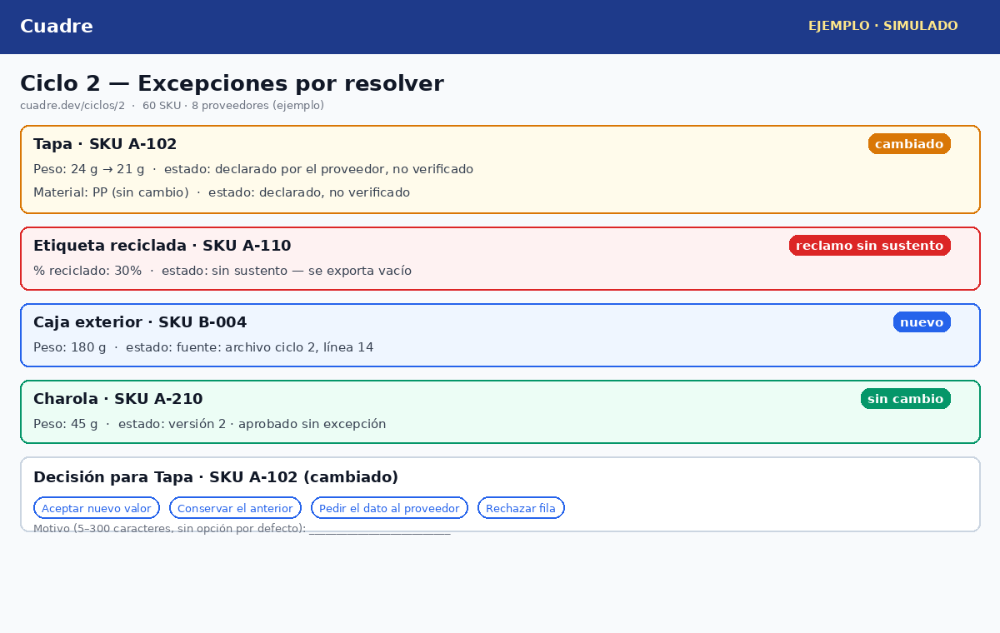
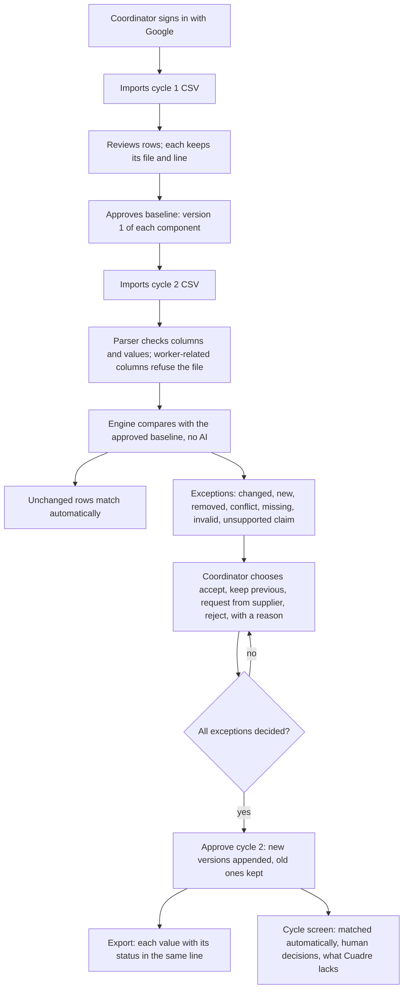
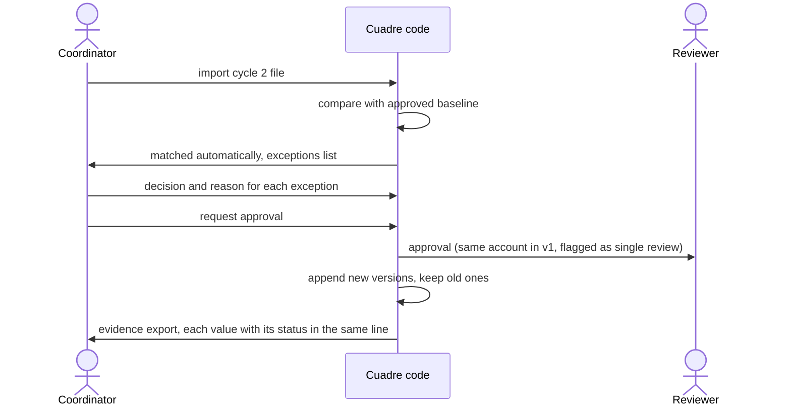

# PACKET: Cuadre (Week 12 core build)

Week 12 · Business Bending · the hinge week · **Emilio Gómez González** · Team 7 · role ADVERSARY
Venture: **Cuadre**, from Week 11 (Chapter 10, Dreaming of Plenitude). Live at **https://cuadre.dev**. Written 1 November 2026, before the Week 12 commits. The Week 11 packet is kept as `PACKET_W11.md`. The charter is `CHARTER.md` and the personas are `PERSONAS.md`.

My Method (Receipts Travel, Step 1) is the engine: **Step 1 of my Method becomes the function that rejects any proposed row whose quoted evidence does not appear word for word in its source, labels a recycled-content claim without evidence "sin sustento", and stores every change as a new version instead of overwriting.**

## 1. Problem, in my words

Mexican producers and importers face new packaging obligations under the Ley General de Economía Circular (published in the Diario Oficial on 19 January 2026). The rulebook is not out: the reglamento's 180-day deadline passed in July, and on 30 August 2026 Expansión still described it as a draft. I have not checked the Diario Oficial directly. So no one can say today which packaging fields will be asked for. What a coordinator can already expect is that whatever is asked will be about her own packaging and will have to be kept current. The first collection from suppliers is the easy part. The second cycle is the hard one: a supplier changes a lid from 24 g to 21 g, drops the document behind a recycled-content claim, or sends a scanned paper receipt. Someone must decide which value is true, say why, and later show who decided.

Cuadre does not claim demand. Condition 2 of the Team 8 Blueprint (15 qualified approaches, 5 samples, 3 paid pilots) has not been done, and I have not timed a second cycle against a spreadsheet. This week's job is one working feature and a venture that can be tested with real people next week.

## 2. Exact user

**Karla, 34** (an invented archetype; see `PERSONAS.md`), regulatory and quality coordinator at a mid-size importer, about 60 SKUs, eight suppliers, data in Excel files and label photos, no ERP. Her reviewer is **Mauricio, 46**. No real coordinator has used Cuadre yet; the Gate 1 interview and the Week 13 tests will replace the invented quotes.

## 3. Success definition

Before the module closes, at **https://cuadre.dev**: a signed-in coordinator imports a cycle-1 CSV (invented and labeled), approves it as the baseline, imports a cycle-2 CSV, sees what changed, what is new, what disappeared and what lacks support, resolves every exception with a choice and a reason (no default), approves cycle 2, and exports an evidence file. In that file, and on the screen, **every value shows its status in the same cell or line**. The cycle screen shows how many rows matched automatically, how many needed a person, and what Cuadre does not have.

## 4. The one core feature (scope cut)

**Second-cycle reconciliation with status that travels.** Input: two supplier files. Logic: Step 1 as code (compare, flag, require a reason, append a version, never state more than the evidence says). Output: an evidence file and a cycle screen. Saved: append-only versions and decisions.

New this week, in order of commits:
1. Charter, personas and this packet (before code).
2. Venture site skeleton: home, `/product` and `/about` with the need, who pays and the 10:1 case, on the real domain.
3. Core-only build: the AI proposal screens, the label-photo reader and the simulated supplier feed are hidden behind a flag and out of the navigation. The code stays; nothing beyond the core is reachable.
4. Status travels: on screen each figure is shown with its status in the same line, and the export gets a `valor_con_estado` column next to the numeric one.
5. Tests, the persona test, a fix, and a redeploy.

## 5. Mockup

`docs/mockup_w12.png`: the exceptions screen of cycle 2 with the status inside each figure's line. Note on how it was made: this session has no image-generation model, so the screen was described in words and drawn with a script from that description. It is a mockup of intent, not a screenshot. All data is invented and labeled "EJEMPLO · SIMULADO".

## 6. Flow: flowchart

## 7. Flow: who does what (swimlane)

More than one actor touches the process: the coordinator, Cuadre's code, and the reviewer.

## 8. Benchmark

The best existing solution on Earth for this need is **Recyda** (Germany): consolidates packaging data, calculates EPR fees under country rulesets, exports declaration formats, says it keeps sources traceable for audit (opened 24 October 2026, vendor marketing). Mine differs: Mexico has no published rulebook, so Cuadre calculates no fee; it works from the Excel or CSV files a small importer already has, with no ERP integration; it is in Spanish; and status travels with every value on screen and in the export, which is new this week and was not in the Week 11 build.

## 9. The long view (3 years)

If this slice works, Cuadre becomes the Spanish-language evidence ledger that sits between a producer's suppliers and whatever format the Mexican authority and any producer-responsibility organization finally require. The load-bearing walls are append-only version history, a human decision with a reason on every change, and the rule that evidence never becomes a claim (`CHARTER.md`, Principles 1 to 4).

## 10. Scope cut: what I am NOT building this week

- No fee calculation, no regulatory declaration, no SEMARNAT filing. The rules are unpublished.
- No AI row proposals, no label-photo reader, no simulated supplier feed. The code stays in the repo behind a flag; none of it is reachable this week.
- No multi-user workspaces, no supplier portal, no payments.
- No environmental-impact or recycling-rate score of any kind.
- No real company data. Demo data is invented and labeled.

## 11. Architecture and stack

| Layer | Choice |
|---|---|
| Frontend | Next.js App Router, Tailwind, Spanish screens (reused from Week 11) |
| Auth | Supabase Auth, Google sign-in |
| Database | Supabase Postgres, RLS on every table; versions and decisions have no update or delete policy |
| Engine | Pure TypeScript functions, deterministic, no AI inside |
| Hosting | Vercel Hobby, domain `cuadre.dev` |

## 12. Test plan

**Mechanical pass.** Reuse the Week 11 offline checks (94 checks); add a check that every exported value's status sits on the same line as the value, and that the core-only build hides the AI, photo and simulated-feed screens from navigation while their code and tests still pass. Find at least one new bug on the live URL, fix it, redeploy.

**Persona test (Layer 1).** Karla (34, regulatory coordinator, short on time, afraid of unsupported claims) walks the live screens from a fresh chat. Log every confusion; fix the worst one.

### Evidence that the packet came before the code

| Commit | Time | What |
|---|---|---|
| (filled at close) | | Charter, personas and this packet |
