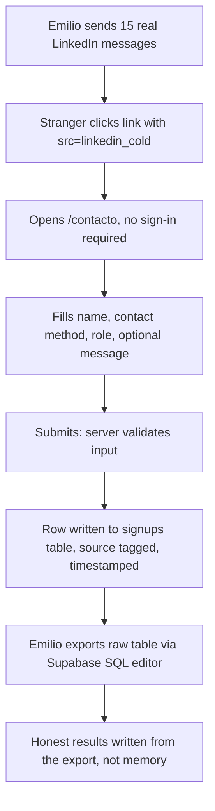
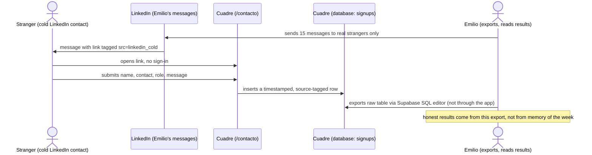

# PACKET: Cuadre (Week 15 — distribution)

Week 15 · Business Bending · **Emilio Gómez González** · Team6 · role OPERATOR
Venture: **Cuadre**, continued from Weeks 11–14. Live at **https://cuadre.dev**. Written 22 November 2026, before any Week 15 code. The Week 14 packet is kept as `PACKET_W14.md`. This week's Brain Bending fight (`CHAT_EmilioGomez.pdf`) and the team Blueprint (`BLUEPRINT_team week 15.pdf`) set the terms below.

## 1. Problem, in my words

Three weeks of Week 13's own recruiting precommit — LinkedIn cold outreach to real strangers, 30-40 messages, before any referral — were written down and quietly skipped under deadline pressure, each time for the same reason. Every real Cuadre tester so far arrived through a warm introduction. Checking the repo directly (not memory) found a second, compounding gap: no lightweight opt-in exists anywhere in the app — the only path for a cold visitor is full Google sign-in. So the honest Week 15 problem isn't which audience or voice to lead with (that fight happened under Money in Week 14 and mostly landed); it's that the mechanical pipe from a stranger seeing something to a stranger landing somewhere to a stranger acting does not exist yet, in either direction, and has never been tested on anyone who didn't already know someone on the team.

## 2. Exact user (and the payer, unchanged from Week 14)

User: a comercio exterior / control de inventario / logística coordinator at a small-to-mid Mexican exporter — the same roles the Week 13 precommit named, never actually cold-tested. Payer: someone like Felipe, a boss who approves a line item up to roughly MXN 10,000/year without a fight (his own stated ceiling, Week 14). This week's user-facing surface is the capture page itself, built for a cold stranger with zero context, not a signed-in user.

## 3. Success definition

Before the module closes: a lightweight capture page at **https://cuadre.dev/contacto** that takes no sign-in, validates its own input, and writes a timestamped row to a `signups` table — tagged by source (`linkedin_cold` vs. everything else), so warm contacts can never contaminate the cold test's own count. 15 real LinkedIn messages, sent only to real strangers in the precommitted target roles, by end of day Tuesday 24 November — two full days before the demo script is opened — each pointing at `/contacto?src=linkedin_cold` and nowhere else. The only evidence this submission carries for "Distribution test" and "Honest results" is a raw export of that table: real rows and timestamps, or a genuinely empty export if nothing came in. Declared in this week's Blueprint: test the opt-in flow, without sign-in, **before** sending a single cold message — so the pipe is proven end-to-end before it depends on a stranger ever using it.

## 4. The one core feature (scope cut)

**A public, no-sign-in opt-in capture page with a source-tagged, timestamped, append-only record — not a CRM, not an automated follow-up, not a finished campaign.**

New this week, in order of commits:
1. This packet (before code).
2. `signups` table (Supabase migration + schema), RLS enabled, insert-only for anonymous visitors, no select policy for any app role — the raw export is read by Emilio directly via the Supabase SQL editor, never exposed through the app itself.
3. `/contacto`: the public capture page — name, how to reach you, role/title (optional), a short message (optional), source captured from the URL's `src` parameter.
4. The launch playbook (below): strategy, brand voice rules, six content concepts across three series, three finished assets across two formats, tested on two of them.
5. The real distribution test: 15 LinkedIn messages to real strangers, sent by Emilio, logged with send timestamps separately from the signups table (so even a zero-signup result is distinguishable from a zero-message result).
6. Redeploy, document before/after, export the real `signups` table regardless of what it contains.

## 5. The launch playbook

**Strategy.** Audience: the comercio exterior / control de inventario coordinator (section 2). Need: stop a shipment getting held over a packing-list mismatch — the one real, costed incident from Week 14's testing, not a compliance story. Positioning: "revisa tu ciclo antes de que el comprador lo haga por ti." Supporting evidence: the Week 13 real-user sessions (five real coordinators, one real incident each) and Week 14's real pricing conversation. One promise I will not make: that Cuadre satisfies any foreign buyer's formal documentation or conformity requirement — the shadow-clause line on every export already exists specifically to prevent that exact claim from being read into the product.

**Brand.** Three voice rules: (1) name a real, specific incident before naming the product — never open with a feature list; (2) every number carries its own status, the same discipline the product enforces on data — a test anchor says so, a real quote says so; (3) no English loanwords where a plain Spanish word exists ("escaneo" not "scan," "ciclo" not "cycle" in copy, even though the code's internal name is `cycle`). One weak line rewritten: "Cuadre optimiza tu cadena de suministro con inteligencia artificial" (vague, sounds like every other pitch) becomes "Si tu último embarque se detuvo por un dato que no cuadraba, esto es para ti" (names the real incident, names the real reader). Palette and type: reused from the live site — slate/blue/amber/green semantic colors already in `components/shell.tsx` and the Tailwind classes across `/pricing` and `/about`, not a new system invented for this week. Visual layout, repeatable: a title line naming the real situation, one amber or blue evidence box with a disclosed number or status, then a single clear next action — the same structure `/pricing` and `/about` already use, reused rather than redesigned.

**Creative range — six concepts across three series, two per series.**

| Series | Concept A | Concept B |
|---|---|---|
| "El ciclo que se detuvo" (real incident stories) | Mauricio's packing-list mismatch, retold as a short post | A second, hypothetical-but-labeled-as-such incident for a different material (contrast with the real one) |
| "El número con estatus" (data discipline as a feature) | A side-by-side: a spreadsheet cell with no source vs. a Cuadre export cell labeled "sin sustento" | A short explainer on why an unverified 0% and an unknown value must never look the same |
| "Antes de que te lo exijan" (pilot urgency, honestly scoped) | A post stating plainly that no Mexican law requires this yet, and why the real pressure some exporters face is their own foreign buyer's packing-list match, not a regulation | A short post addressed directly to a coordinator, not a compliance officer — "si tú eres quien revisa el ciclo, esto es para ti, no para tu jefe" |

Finished this week, one per series, across at least two formats: (1) "El ciclo que se detuvo" as a LinkedIn-ready text post (format: text); (2) "El número con estatus" as a static image card generated from the live `/pricing`-style visual system (format: image); (3) "Antes de que te lo exijan" as the `/contacto` page's own headline and body copy (format: web page, the "shareable venture page" the brief explicitly allows in place of social posts). The other three concepts stay as labeled sketches/headlines, not built out, per the brief's own scope limit.

**Distribution test.** Two of the three finished assets go in front of the real audience: the LinkedIn text post (sent as the body of the 15 cold messages themselves, not a separate public post — the brief permits "a shareable venture page with suitable opt-in outreach" in place of a public account, and a public LinkedIn post would reach people outside the precommitted target roles, diluting rather than testing the channel) and the `/contacto` page itself (the thing every message points to). The image asset is tested informally, shown to one real contact for a reaction, not sent to strangers this week — logged as a sketch-level test, not a claim of real audience data.

**Honest results.** Recorded after Tuesday, from the raw `signups` export and the real send log — not from memory, and not reworded into a better story than the numbers support. Zero response is an explicitly valid, logged result, not a reason to widen the test or quietly add warm contacts to the count.

## 6. Mockup

`docs/mockup_w15_contacto.png`: the `/contacto` page, showing the real-incident headline, the short form (name, contact, role, message), and the honest absence of any sign-in requirement. Drawn from a written description by a script (no image-generation model available this session, same disclosure as Weeks 11–14). Not a screenshot.

## 7. Flow: flowchart

## 8. Flow: who does what (swimlane)

## 9. Benchmark

Vendor-aggregated 2026 data (Belkins and adjacent sales-tooling sources) puts cold LinkedIn message reply rates at roughly 5-15% typically, averaging 10-11%, with good performers at 25-35%; B2B SaaS specifically is flagged as the most saturated, lowest-reply segment, under 5%. No Mexican- or Spanish-language-specific benchmark was found — the honest translation step is to treat Cuadre's own 15 messages as a first real data point rather than a test against someone else's number: at n=15, the benchmark's own range predicts 0-2 replies, so zero would be within normal variance, not evidence the method failed. What the global data can't tell us, and this week's test is actually for: whether a Mexican SME coordinator responds differently to a Spanish-language cold message naming a real, specific incident, versus the generic English-language SaaS pitches the benchmark data is mostly drawn from.

## 10. The long view (3 years)

Unchanged in substance from `CHARTER.md` and Week 14's packet: a durable channel, once proven, likely needs to split the same way the pricing segments did — a direct, incident-led message to coordinators for the domestic/packing-list-accuracy case, and a separate, compliance-framed message for the (still unconfirmed) segment of exporters facing real EU/California buyer pressure. Collapsing both into one generic pitch would dilute the one real, evidence-backed promise this week's test actually has. Explicitly out of scope to build this week — logged so it isn't forgotten, not solved by accident.

## 11. Scope cut: what I am NOT building this week

- No automated follow-up sequence, drip campaign, or CRM — 15 messages, sent and logged by hand, once.
- No public social media account or post — the brief explicitly allows a shareable venture page with opt-in outreach in its place, and a public post would reach people outside the precommitted target roles.
- No claim that a signup equals a sale, or that zero signups means the product has no market — this week tests the pipe, not the market size.
- No warm contacts in the cold-test count, under any circumstance — the Blueprint's own condition.
- No real personal data in any demo or seed; the `signups` table itself will hold real contact information from real people who opted in, which is why it has no select policy exposed through the app at all, not even to a signed-in Cuadre user.

## 12. Architecture and stack

| Layer | Choice |
|---|---|
| Frontend | Next.js App Router, Tailwind, Spanish screens (reused) |
| Auth | None required for `/contacto` — the whole point this week is a path that does not gate on sign-in |
| Database | Supabase Postgres; `signups` table, RLS enabled, insert-only for the `anon` role, no select policy for any app role |
| New this week | `signups` table (name, contact, role, message, source, created_at) — the stack-floor-equivalent addition: a real, testable capture mechanism |
| Hosting | Vercel Hobby, domain `cuadre.dev` (reused) |

## 13. Test plan

**Mechanical pass.** Reuse the Week 14 offline checks (130 checks); add checks for the signup input validation (length limits, required vs. optional fields, source defaulting correctly when the URL parameter is absent).

**Persona pass (Layer 1, synthetic, not a real session).** A fresh-chat persona built from Week 13's real-user evidence — a skeptical comercio exterior coordinator who has never heard of Cuadre, arriving cold with no context — walked through `/contacto` to find where the page itself confuses or loses someone with zero prior exposure to the product. Findings logged in `PERSONA_EmilioGomez.pdf` (this week).

**The one real test that matters more than the persona pass.** 15 real LinkedIn messages to real strangers, sent by end of day Tuesday 24 November, logged with send timestamps; whatever the `signups` table shows afterward, exported raw and reported honestly, including zero.

### Evidence that the packet came before the code

| Commit | Time | What |
|---|---|---|
| (filled at close) | | This packet |
