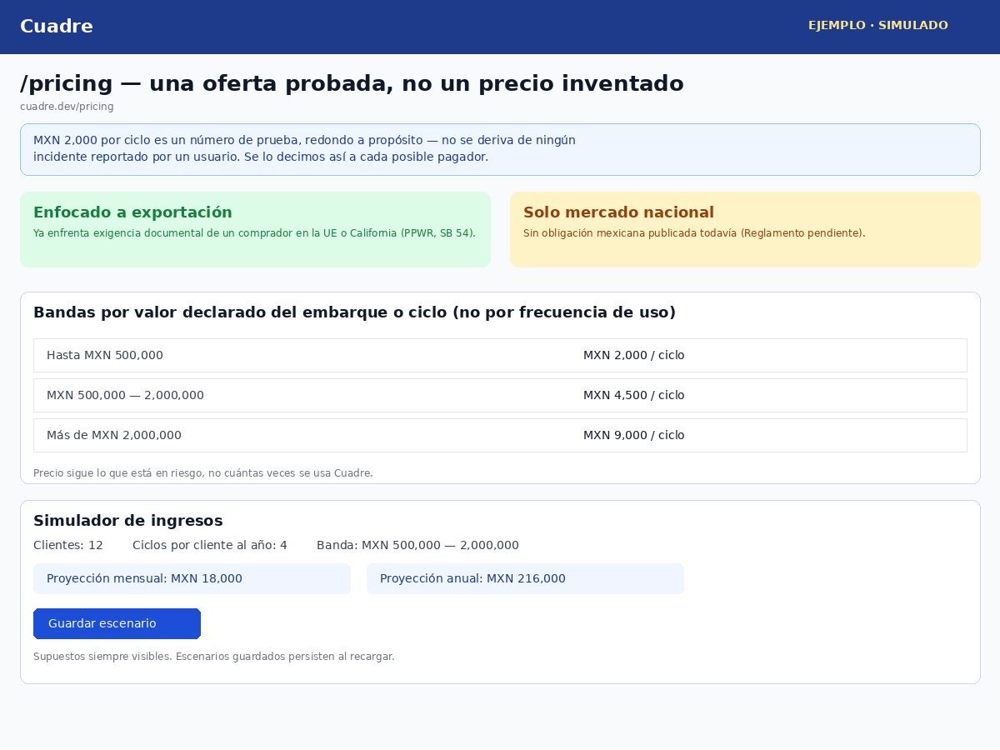
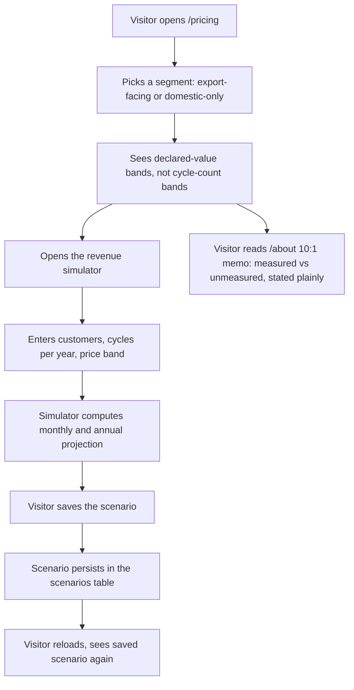
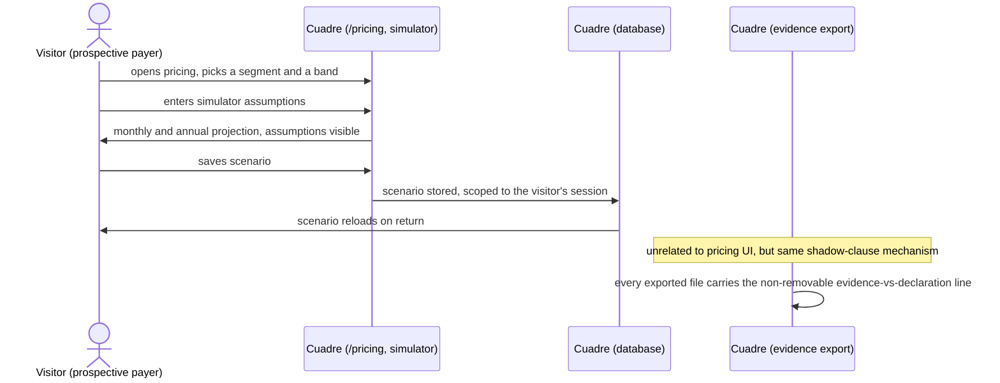

# PACKET: Cuadre (Week 14 — pricing)

Week 14 · Business Bending · **Emilio Gómez González** · Team 6 (rotation changed this week) · role MONEY
Venture: **Cuadre**, continued from Weeks 11–13. Live at **https://cuadre.dev**. Written 15 November 2026, before any Week 14 code. The Week 13 packet is kept as `PACKET_W13.md`. The charter is `CHARTER.md`; this week's Brain Bending fight (`CHAT_EmilioGomez.pdf`) and the team Blueprint (`BLUEPRINT_Team6_Week14.pdf`) set the terms below — declared build: a scoped-cycle offer, payer qualification, and a cost sheet (Blueprint Conditions 1–3).

## 1. Problem, in my words

Cuadre has never had a price, and the fight this week found that the honest reason isn't laziness — it's that the two most tempting pricing stories both collapse under their own evidence. Story one, a regulatory payer: Mexico's Ley General de Economía Circular (19 Jan 2026) created the legal basis for extended producer responsibility, but its Reglamento — the piece that would force a specific producer or importer to act — missed its own 180-day deadline in July and was still "en proceso" as of the most recent check. No domestic regulatory payer exists today. Story two, a SaaS subscription: the value Cuadre actually protects against — a held shipment, a stopped production line, a costly packaging mismatch — is event-driven and contingent, not a steady monthly habit, so a flat recurring fee prices the wrong shape of value entirely. What's real instead: Mexican exporters already face a live, foreign-buyer-driven trigger — the EU's Packaging and Packaging Waste Regulation (importer obligations in force since 12 August 2026) and California's SB 54 (regulations finalized May 2026) both require packaging documentation from a supplier today, with no dependency on Mexican law. That's a narrower market than "every Mexican producer," and it's unconfirmed whether the one real contact available this week (Mauricio, from Week 13's sessions) is even in it.

## 2. Exact user (and exact payer — this week's actual question)

The user is unchanged from `CHARTER.md`: a packaging-data coordinator at a small-to-mid Mexican producer or importer. The payer is not that person — five real sessions in Week 13 independently found the coordinator never controls a budget line. Who actually signs a recurring expense is still Unknown, not Estimated: no session asked the question of an actual budget holder. This week's required real pricing conversation (see section 3) is the first attempt to close that gap, not a confirmation of it.

## 3. Success definition

Before the module closes, at **https://cuadre.dev**: `/pricing` states a scoped-cycle offer — a per-reconciliation-cycle fee, banded by declared shipment/inventory value (not by frequency of use, since the value is risk-shaped, not usage-shaped) — across two segments (export-facing vs. domestic-only), with a working revenue simulator (inputs: number of customers, cycles per customer per year, price band → monthly/annual projection, assumptions visible, scenarios savable). `/about` carries a one-page 10:1 memo that states plainly what is measured and what is not: the per-cycle anchor (MXN 2,000, explicitly disclosed as a deliberately round test number, not derived from any user's reported cost) is tested against an actual potential payer this week, and the result — whatever it is — is recorded, not smoothed over into a confident claim the evidence doesn't support.

## 4. The one core feature (scope cut)

**A scoped-cycle pricing offer, a payer-qualification question set, and a cost sheet — not a finished billing system.** This is the Blueprint's Conditions 1–3, and this week's declared build.

New this week, in order of commits:
1. This packet (before code).
2. `/pricing`: 2-3 tiers as declared-value bands (not cycle-frequency bands — the Brain Bending fight's own correction), 2 segments (export-facing, domestic-only), explicit "tested anchor, not a derived price" disclosure.
3. Revenue simulator with saved scenarios (this week's required stack addition): inputs visible, assumptions visible, a `scenarios` table so a saved projection survives a reload.
4. `/about` 10:1 memo: one page, what the user does today (a spreadsheet, retyping, no timed baseline), what it costs (not measured — stated as such, not invented), the price, and the honest state of the ratio.
5. The shadow-clause mechanism from this week's fight: the evidence export carries a non-removable field — "soporte de evidencia, no es una declaración de conformidad" — on every row, every export, every tier, plus a new `scripts/verify.ts` check that fails the build if any export path produces a file without that line present.
6. The real pricing conversation with Mauricio: would he pay ~MXN 2,000/cycle, and does he actually export to a market with live buyer-side packaging-documentation pressure. Recorded in `DECISIONS.md`, whatever the answer.
7. Redeploy, document before/after.

## 5. Mockup

`docs/mockup_w14_pricing.png`: the `/pricing` page showing the two segments, the declared-value bands, and the "tested anchor, not a derived price" disclosure line. Drawn from a written description by a script (no image-generation model available this session, same disclosure as Weeks 11–13). Not a screenshot.

## 6. Flow: flowchart

## 7. Flow: who does what (swimlane)

## 8. Benchmark

The best existing pricing model for this shape of value is **parametric insurance** (products like FloodFlash), which prices by value-at-risk rather than frequency of use — exactly the logic an averted-incident argument needs, and the model this week's fight landed on only after dropping a SaaS-tier reflex twice. Adjacent compliance software — **Avetta** and **Veriforce** — price per supplier or per audit, scaling with exposure, not a flat seat license, which is further evidence that value-banded pricing is normal in compliance software generally, not something invented for this memo. Neither exists in this shape for Mexican packaging/circular-economy compliance. What doesn't translate is not the pricing logic — it's the trigger: global players price against a live, enforced obligation; Mexico's own obligation still isn't published, so the real local market today is the narrow slice of producers already facing a foreign buyer's documentation demand, not the whole addressable set.

## 9. The long view (3 years)

Unchanged in substance from `CHARTER.md`'s north star — a timed, honest 10:1 ratio against a real baseline — sharpened by this week's finding: a durable pricing model for Cuadre will likely need two genuinely different products under one roof, a low-friction export-compliance-support tool priced against shipment value for the urgent segment, and a different, probably much cheaper or free, internal-record-keeping tool for the domestic-only segment that has no live trigger yet. Collapsing those into one price would either overcharge the segment with no urgency or undercharge the one that has a real, event-driven reason to pay. Explicitly out of scope to build this week — logged so it isn't forgotten, not solved by accident.

## 10. Scope cut: what I am NOT building this week

- No real billing integration (Stripe metered billing, invoicing) — commodity mechanics with nothing yet to bill against.
- No claim that Cuadre's evidence export satisfies PPWR's declaration-of-conformity or technical-documentation requirement — it supports a compliance file; it is not one, and the export says so, enforced, not just claimed in copy.
- No confirmed second real pricing conversation — one real contact, one segment tested at most. The brief states this as the honest open state of Week 14, not a quietly assumed pass on both segments.
- No CRM, no sales pipeline, no lead capture beyond what's needed to record the one real conversation.
- No real company data. Demo data in the simulator is invented and labeled, same as every prior week.

## 11. Architecture and stack

| Layer | Choice |
|---|---|
| Frontend | Next.js App Router, Tailwind, Spanish screens (reused) |
| Auth | Supabase Auth, Google sign-in (reused) |
| Database | Supabase Postgres, RLS on every table; versions and decisions append-only |
| Engine | Pure TypeScript functions for the simulator math, deterministic, no AI inside |
| New this week | A `scenarios` table (inputs, computed projection, user id, timestamp) — the stack-floor addition: working calculator logic with saved scenarios |
| Hosting | Vercel Hobby, domain `cuadre.dev` |

## 12. Test plan

**Mechanical pass.** Reuse the Week 13 offline checks (110 checks); add checks for the simulator math (given fixed inputs, exact projection), the scenario save/reload round-trip, and the new evidence-export shadow-clause line (fails the build if any export path omits it).

**Real-human pass (Layer 1 this week — a synthetic persona, not a sixth real session).** A fresh-chat persona built from the Week 13 real-user evidence, walked through `/pricing` and the simulator as a coordinator who is NOT the budget holder, to find where the pricing page itself confuses the wrong audience (a coordinator reading a page meant for her boss). Findings logged in `PERSONA_EmilioGomez.pdf` (this week).

**The one real conversation that matters more than the persona test.** Mauricio, this week: would he pay ~MXN 2,000/cycle, and is he actually in the export-facing segment. Logged in `DECISIONS.md` regardless of outcome.

### Evidence that the packet came before the code

| Commit | Time | What |
|---|---|---|
| (filled at close) | | This packet |
