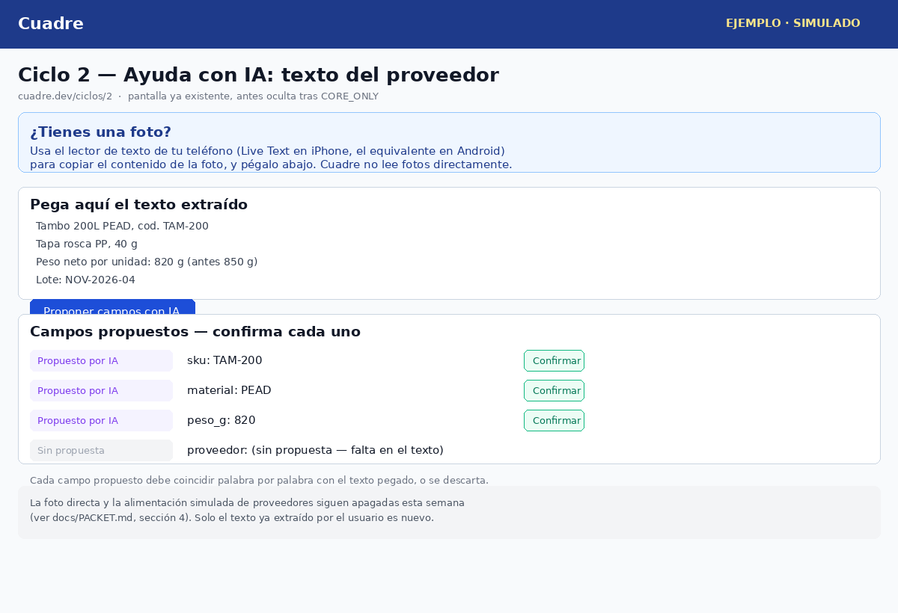
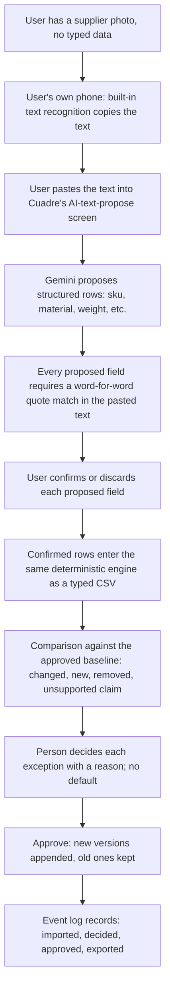
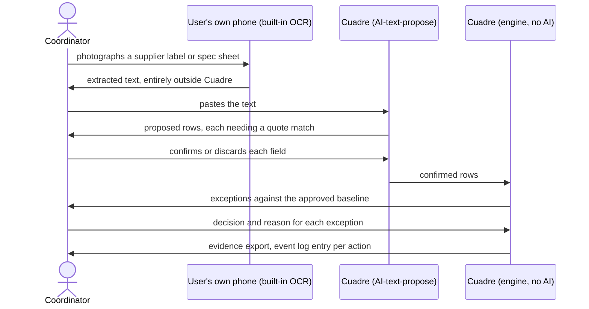

# PACKET: Cuadre (Week 13 — real humans)

Week 13 · Business Bending · **Emilio Gómez González** · Team 7 · role TECHNOLOGIST
Venture: **Cuadre**, continued from Weeks 11–12. Live at **https://cuadre.dev**. Written 8 November 2026, before any Week 13 code. The Week 12 packet is kept as `PACKET_W12.md`. The charter is `CHARTER.md`, personas are `PERSONAS.md`, and the recruiting discipline for this week's real-user sessions is `W13_RECRUITING_PRECOMMIT.md`.

## 1. Problem, in my words

Five real strangers — a quality coordinator at a food plant, a quality intern at a cosmetics contract manufacturer, a quality and compliance chief at a fertilizer producer, a foreign-trade and inventory coordinator at an LED-fixture assembler, and an inventory-control lead at a faucet maker — all independently confirmed the same underlying harm: a supplier changes something about a packaging component (a material, a weight, a bundle size) without telling anyone, and the person who finds out is not the person who could have caught it in time. The cost is not hypothetical: a held shipment in Costa Rica, three months of excess bags, 4,000 boxes made obsolete, a production line stopped for half a day, a MXN 180,000 discrepancy that took three days to rebuild from WhatsApp messages. In four of five sessions, the person using Cuadre was explicitly not the person who talks to the supplier — that conversation belongs to someone else (compras, planeación, a boss), which means Cuadre's single-reviewer model is narrower than how these companies actually work.

Cuadre's own comparison engine (built and tested with invented data in Weeks 11–12) already does the one thing that matters here: it never lets a changed value pass silently. What this week's five sessions found is that the path to getting real data into that engine is still broken — every one of the five would have had to retype the same information they already have somewhere else, which none of them will do daily.

## 2. Exact user

Confirmed this week, not invented: a person whose job touches supplier packaging data directly — calidad, cumplimiento, comercio exterior or control de inventario — at a small-to-mid Mexican producer or importer (55 to 120 employees in this week's five sessions), with no ERP or WMS for this task. See the real-user-test log (`PERSONA_EmilioGomez.pdf`, this week) for the five actual people and their exact words. New this week: the data-entry person, the decision-maker and the economic buyer are frequently three different people (a boss or plant manager approves spending; compras or planeación often holds the fact a reviewer needs).

## 3. Success definition

Before the module closes, at **https://cuadre.dev**: a signed-in user can paste text they already extracted from a supplier photo using their own phone's built-in text recognition (no new OCR built by Cuadre) into a screen that proposes structured rows, confirms every AI-touched field before it counts, and feeds the same deterministic comparison engine as a typed CSV — with the simulated feed and the photo-reader staying off, on purpose. This is tested against real phone-extracted text (accents, abbreviations like "pza" or "kg neto", mid-field line breaks), not only clean invented data, and the before/after evidence is documented and redeployed.

## 4. The one core feature (scope cut)

**Re-enable and validate the already-built paste-text path, split cleanly from the still-unproven photo and simulated-feed paths.** This is the #1 pain from this week's five sessions (double-entry, confirmed by all five, unanimous) — not a new feature, a narrower fix: `CORE_ONLY` splits into independent flags so the paste-text AI-propose screen can come back without also re-exposing the photo reader or the simulated feed. A line of copy tells the user how to get text out of a photo using their own phone. The schema check is tested against real extracted text, not just clean demo data.

New this week, in order of commits:
1. This packet (before code).
2. Split `CORE_ONLY` into `AI_TEXT_ENABLED` (on) and `AI_PHOTO_ENABLED` / `SIM_FEED_ENABLED` (stay off); re-expose the paste-text screen; add the phone-text-recognition copy line.
3. A minimal event log (this week's required stack addition): key actions (cycle created, file imported, exception decided, cycle approved, export downloaded) recorded with a timestamp and user id, queryable later — not a dashboard, just a durable record that usage happened.
4. Best-effort, not required: fix the approval-timestamp timezone bug (confirmed by all five sessions, shown in server/UTC time instead of the viewer's local time) and loosen the "removed" exception's forced "pedir el dato al proveedor" wording (confirmed wrong address in four of five sessions — the real answer is often internal).
5. Redeploy, document before/after.

## 5. Mockup

`docs/mockup_w13.png`: the paste-text screen with the new phone-text-recognition line, drawn from a written description by a script (no image-generation model available this session, same disclosure as Weeks 11–12). Not a screenshot.

## 6. Flow: flowchart

## 7. Flow: who does what (swimlane)

More than the coordinator touches this chain — the phone's own software, the AI, and the coordinator all do distinct work, and the supplier is not even part of it until a decision asks for more data.

## 8. Benchmark

The best existing solution on Earth for packaging-data consolidation is still **Recyda** (Germany) and **Specright** (US), and this week's five real sessions confirmed precisely where they don't translate: both assume the producer already has clean, structured data, from an ERP. None of this week's five real users had one. The unlock this week is narrower than "build OCR" — it is routing around the gap using a capability every real user's phone already has (iOS Live Text, Android's equivalent), feeding Cuadre's existing, tested paste-text screen. This is new since Week 12: the plan to use phone-native text recognition was a hypothesis in the Week 13 Brain Bending fight; this week five real users independently confirmed double-entry is the pain that actually blocks adoption, which is the evidence the hypothesis needed.

## 9. The long view (3 years)

Unchanged in substance from `CHARTER.md`, sharpened by this week's finding: the real organization using Cuadre is not one person but three roles (the one who receives supplier data, the one who decides, the one who pays), so a durable version of Cuadre eventually needs more than one account per workspace, with the single-reviewer disclosure (`CHARTER.md` Principle 5) becoming a real second role rather than a caveat. That is explicitly out of scope this week — logged here so it is not forgotten, not solved by accident.

## 10. Scope cut: what I am NOT building this week

- No multi-role accounts. The single-reviewer model stays, and the disclosure stays honest about it.
- No new image-to-text extraction built by Cuadre. The phone's own OCR does that work, outside Cuadre.
- No unit-of-measure fields (atado, rollo, paquete, piezas por unidad) — confirmed missing by two of five real users (Mauricio, Luis Fernando), a real schema gap, too large to add safely this week.
- No lot-effective-dating ("from which receipt does the new weight apply") or SKU-replacement linking — both named by Luis Fernando, both real, both future work.
- No real company data. Demo data is invented and labeled, same as every prior week.

## 11. Architecture and stack

| Layer | Choice |
|---|---|
| Frontend | Next.js App Router, Tailwind, Spanish screens (reused) |
| Auth | Supabase Auth, Google sign-in (confirmed friction point for non-Gmail work accounts, logged, not fixed this week) |
| Database | Supabase Postgres, RLS on every table; versions and decisions append-only |
| Engine | Pure TypeScript functions, deterministic, no AI inside |
| New this week | A minimal event log table (action, user id, timestamp) — the stack-floor addition for Week 13 |
| Hosting | Vercel Hobby, domain `cuadre.dev` |

## 12. Test plan

**Mechanical pass.** Reuse the Week 12 offline checks (101 checks); add checks for the event log and for the split flags (paste-text reachable, photo and simulated feed still refused server-side). Test the schema parser against real phone-extracted text samples, not only clean invented data.

**Real-human pass (Layer 2, already run before this code).** Five real strangers, three-plus required, five industries covered, all four precommitted roles represented. Findings and ranking in `PERSONA_EmilioGomez.pdf` (this week's real-user-test log) and `DECISIONS.md`. The #1 pain (double-entry) is what this packet's build targets; before/after evidence is required once redeployed.

### Evidence that the packet came before the code

| Commit | Time | What |
|---|---|---|
| `120d8cd` | 8 Nov 2026, 20:47 | This packet, `PACKET_W12.md` archive, `mockup_w13.png` — committed before any Week 13 code change |
